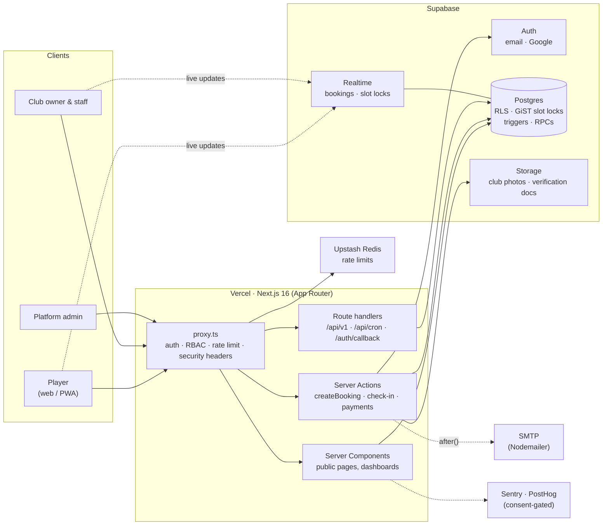

<div align="center">


# Moovi

**Padel, tennis and football court booking SaaS for Tunisia.**
Players book a court in seconds. Clubs run courts, staff, check-ins and revenue from one dashboard. An autonomous agent engine fights no-shows and fills 3/4 matches on its own.

[**Live site**](https://moovitn.vercel.app) · [Book a court](https://moovitn.vercel.app/courts) · [For clubs](https://moovitn.vercel.app/espace-club)

[](https://github.com/amineakremi07/SHIFTGRID/actions/workflows/ci.yml)


</div>

---

## Contents

- [Screenshots](#screenshots)
- [What it does](#what-it-does)
- [Architecture](#architecture)
- [Engineering highlights](#engineering-highlights)
- [Tech stack](#tech-stack)
- [Brand palette](#brand-palette)
- [Getting started](#getting-started)
- [Testing and verification](#testing-and-verification)
- [Project structure](#project-structure)
- [Roadmap](#roadmap)

## Screenshots

<!-- Placeholders: replace each URL with a real capture saved under docs/screenshots/ (e.g. docs/screenshots/landing.png). -->

| Landing page | Club page and slot grid |
|:---:|:---:|
|  |  |
| **One-screen checkout (mobile)** | **Club dashboard: bookings board** |
|  |  |
| **Analytics (TND)** | **Admin: club verification** |
|  |  |

## What it does

Moovi has three separate doors, each with its own entry point and its own permissions.

| | Who | Entry point | What they get |
|---|---|---|---|
| **B2C** | Players | `/` → *Réserver un terrain* → `/courts` | Log in or sign up, find a club, see live availability, book |
| **B2B** | Club owners and staff | `/espace-club` → `/register?role=owner` or `/login-owner` | Club dashboard: schedule, walk-ins, check-in, payments, analytics, team |
| **Platform** | Moovi admins | `/admin` | Club verification and account security. Never shown on public pages |

### For players

- **Live slot grid.** Every court shows its real free slots for the day, updated in real time when someone else books.
- **Account required, one-screen checkout.** Booking needs a player account (email or Google). Picking a slot while signed out opens the sign-in / sign-up dialog, then goes straight to checkout; club members confirm in one tap.
- **Réserver à nouveau.** From *Mes réservations*, rebook the same court, weekday and time at its next free date in one click.
- **Pass with check-in code and QR**, add to calendar, contact the club on WhatsApp.
- **Free cancellation** up to 24 hours before the match, from *Mes réservations*.
- **Split payment** between up to 4 players (sandbox gateway today, see [Roadmap](#roadmap)).

### For clubs

- **Bookings board** per court: online, desk and phone bookings on one live grid; manual bookings with staff-only notes.
- **Check-in** by 6-digit code, QR scan (camera or USB scanner), and **no-show tracking**: a trust score per player, automatic 30-day suspension after the third no-show.
- **Payments**: mark cash as paid, see what is still to collect; night-lighting surcharge applied automatically.
- **Analytics in TND**: revenue today / week / month / year, occupancy by hour, peak vs off-peak, top courts, cancellations, members vs guests.
- **Club profile**: bio, photo gallery, exact location on an OpenStreetMap / Leaflet map with directions.
- **Team**: invite receptionists by email; staff manage bookings, owners keep courts, prices, hours and analytics.
- **Verification**: every club is checked by a platform admin (registration document) before it appears publicly.

### Guarantees built into the database

- **No double booking, ever.** A PostgreSQL GiST exclusion constraint on `court_slot_locks` rejects any overlapping booking inside the same transaction (`23P01` / `23505` → *"Ce créneau vient d'être réservé"*).
- **Multi-tenant isolation** with Row-Level Security on every table; prices, sport and member identity are always derived on the server.
- **History is never hard-deleted**: courts and clubs are archived, players are anonymised on request (Tunisian Law 2004-63).

## Architecture



**How a booking flows:** the slot grid is generated from the court's hours (`lib/court-slots.ts`) and the slot locks; the drawer calls the `createBooking` Server Action, which validates input with a strict Zod schema, re-checks the slot and price (`lib/booking-core.ts`), then calls the `create_booking()` RPC. That one transaction inserts the booking; triggers derive the times, assign the court and create the lock; the payment record follows. Confirmation emails are sent in Next's `after()` so they never slow the booking down, and Realtime pushes the new lock to every open grid.

**Roles:** `platform_admin` › `org_admin` (owner) › `staff` › `player`, enforced three times: the proxy, the page or action (`getOrgAccess()` / `requireOrgAction()`), and RLS.

## Engineering highlights

### Autonomous agent engine

A single Deno **Supabase Edge Function** (`supabase/functions/autonomous-agents`) is triggered every 10 minutes by `pg_cron` + `pg_net`. The cron command holds no secret: the project URL and shared secret are read from Supabase Vault at each run, and the function authenticates the call with a constant-time SHA-256 comparison.

| Step | Agent | What it does |
|---|---|---|
| 1 | `anti_no_show.request` | Asks players to confirm presence for bookings starting in 6 to 24 hours |
| 2 | `anti_no_show.release` | **H-4 scanner**: four hours before kickoff, releases (cancels) bookings still unconfirmed, for opted-in clubs only, so the slot goes back on the market |
| 3 | `matchmaker.expire` | Closes searches whose time window is over |
| 4 | `matchmaker.match` | **3/4 player matchmaker queue**: seats open searches into compatible open matches, filling 3/4 matches to 4/4 first |
| 5 | `outbox.flush` | Asks the Next app to deliver queued emails through the SMTP outbox |

Design rules that keep it safe to run unattended:

- **The edge function only decides order, the database decides truth.** Ranking logic lives in pure functions (`matchmaking.ts`, unit-tested without Deno or network); every state change happens inside a `service_role`-only RPC that re-validates all rules.
- **Isolated steps.** Each step has its own try/catch; a failure is written to `system_logs` (with e-mail and token scrubbing) and the next step still runs.
- **Idempotent.** Overlapping or duplicated cron runs cannot release or seat a player twice.

### Atomic SQL locking

- Bookings are only created through the `create_booking()` RPC, in one transaction.
- A **GiST exclusion constraint** on `court_slot_locks` rejects any overlapping time range (`23P01`, same start `23505`), so double booking is impossible even under concurrent requests. Both errors map to a single "slot taken" message.
- Payment, check-in, reassignment, release and match-seating RPCs run `SELECT ... FOR UPDATE` on the booking row first, are granted to `service_role` only, and derive price, sport and member identity server-side.
- Cancelling is `UPDATE status = 'cancelled'`; a trigger frees the lock. History is soft-deleted, never hard-deleted.
- `scripts/verify-booking-concurrency.mjs` fires parallel bookings at the same slot and asserts exactly one wins.

## Tech stack

<p>
  
</p>

| Layer | Choice |
|---|---|
| Framework | Next.js 16 (App Router, Server Actions, Turbopack, `proxy.ts`), React 19 |
| Language | TypeScript (strict), Zod for every input |
| UI | Tailwind CSS v4, shadcn/ui (Radix), Framer Motion, lucide-react, Recharts, Leaflet / OpenStreetMap |
| Data | Supabase: Postgres + RLS, Auth (email, Google), Realtime, Storage |
| Automation | Deno Edge Functions, `pg_cron`, `pg_net`, Supabase Vault |
| Email | Nodemailer (SMTP) with an outbox table and idempotent retries |
| Security | Strict CSP, HSTS, Upstash rate limiting, MFA for admins |
| Observability | Sentry (scrubbed), PostHog (consent-gated, masked recordings) |
| Testing | Playwright (unit and E2E), DB verification scripts, k6 load test |
| Hosting | Vercel |

## Brand palette

Defined as tokens in `app/globals.css`; the rules live in [`docs/DESIGN.md`](docs/DESIGN.md).

| | Token | Hex | Role |
|:---:|---|---|---|
|  | Bone Linen | `#f7f5f2` | Page canvas |
|  | Oat Milk | `#eae6df` | Cards, raised panels |
|  | Lime Pulse | `#26d862` | Primary action only, one per screen |
|  | Obsidian Plum | `#2a1a1d` | Text |
|  | Peacock Teal | `#0e634f` | Status, available slots |
|  | Forest Depths | `#1d3023` | Hero and B2B surfaces |
|  | Driftwood | `#d7d2cc` | Hairlines and borders |
|  | Ash Mauve | `#645757` | Secondary text |

Hierarchy comes from the surface step (Bone Linen → Oat Milk), type and spacing, not from shadows. Motion uses one spring everywhere (`stiffness: 400, damping: 25`) and respects reduced motion.

## Getting started

### Prerequisites

- Node.js 20.9 or later, npm
- A Supabase project (hosted, or local with the Supabase CLI and Docker)
- The [Supabase CLI](https://supabase.com/docs/guides/cli) to apply migrations

### 1. Install

```bash
git clone <your-fork-url> moovi
cd moovi
npm install
```

### 2. Configure

```bash
cp .env.example .env.local
```

Fill in at least:

| Variable | Where it comes from |
|---|---|
| `NEXT_PUBLIC_SUPABASE_URL`, `NEXT_PUBLIC_SUPABASE_ANON_KEY` | Supabase → Project Settings → API |
| `SUPABASE_SERVICE_ROLE_KEY` | Same page, **secret** key (server only, bypasses RLS) |
| `NEXT_PUBLIC_APP_URL` | `http://localhost:3000` locally |

Everything else is optional and off when unset: SMTP (`SMTP_HOST`… → emails are recorded as `skipped`), Upstash (in-memory rate limiter), Sentry, PostHog, `CRON_SECRET`. `.env.example` documents each one.

### 3. Database

```bash
supabase link --project-ref <your-project-ref>
supabase db push            # applies every file in supabase/migrations
```

Optional: deploy the agent engine (see the header of `supabase/snippets/schedule_autonomous_agents.sql` for the cron setup):

```bash
npx supabase secrets set AGENTS_SECRET=<32+ random chars> APP_URL=http://localhost:3000 CRON_SECRET=<same as .env.local>
npx supabase functions deploy autonomous-agents --no-verify-jwt
```

Optional development accounts (one per role, plus an approved test club):

```bash
SEED_PASSWORD='<12+ chars>' node scripts/seed-all-roles.mjs     # admin@ / owner@ / staff@ / player@shiftgrid.local
```

> Never run the seed scripts against a production project.

### 4. Run

```bash
npm run dev        # http://localhost:3000
```

| Path | What you see |
|---|---|
| `/` | Landing page (players and clubs) |
| `/courts` | Club finder, the booking interface (sign-in required) |
| `/courts/<clubId>` | A club's slot grid and checkout |
| `/espace-club` | Club owner onboarding |
| `/dashboard/org` | Club dashboard (owner / staff) |
| `/admin` | Platform admin (role `platform_admin`) |

## Testing and verification

```bash
npm run typecheck       # types
npm run lint             # eslint
npm run build            # production build (Turbopack)

E2E_SKIP_SEED=1 npx playwright test tests/rebook.spec.ts tests/validation.spec.ts   # pure unit specs, no database writes
npm run test:e2e         # full browser suite: seeds test accounts and books real slots in the configured project
npm run verify:db        # payments, concurrency, RLS security, data retention (against the database)
```

Point the E2E suite at a dedicated project with `TEST_SUPABASE_URL`, `TEST_SUPABASE_ANON_KEY` and `TEST_SUPABASE_SERVICE_ROLE_KEY` so it never touches production data. Load testing (k6) and the launch-readiness check (`npm run verify:launch`) are described in [`docs/PROJECT_LOG.md`](docs/PROJECT_LOG.md).

## Project structure

```
app/                 Routes (App Router)
  page.tsx           Landing · espace-club/ (B2B) · admin/ (platform)
  courts/            Club finder (sign-in required) · [orgId]/ slot grid + checkout
  reservations/      Player bookings, pass, guest cancel, split payment
  dashboard/org/     Club dashboard: bookings, courts, settings, staff, analytics
  api/               v1 API (API keys), cron, auth
components/          UI by domain: booking, courts, dashboard, home, nav, ui (shadcn)
lib/                 Domain logic: booking-core, court-slots, pricing, rebook, payments…
  actions/           Server Actions
  validations/       Zod schemas
supabase/migrations/ Schema, RLS, triggers, RPCs
supabase/functions/  Deno Edge Function: autonomous agents (anti-no-show, matchmaker)
scripts/             Seeds, verification, load test
tests/               Playwright specs (unit + E2E)
proxy.ts             Auth, roles, rate limiting, security headers
```

## Roadmap

Current status, open work and milestone progress: [`docs/PROJECT_MEMORY.md`](docs/PROJECT_MEMORY.md). History: [`docs/PROJECT_LOG.md`](docs/PROJECT_LOG.md).

---

<div align="center">
<sub>Built in Tunisia · Prices in TND · Interface in French</sub>
</div>
